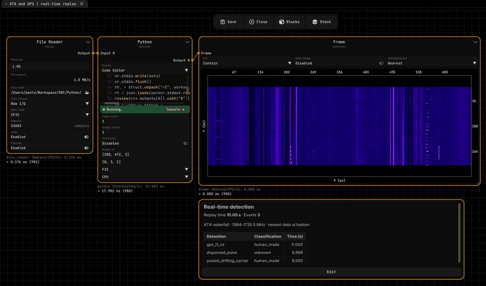

# CyberEther real-time replay

The Python block imports the installed `seti-rf` package and processes
the replay as it arrives. CyberEther shows a scrolling ATA waterfall and
a detection table. The demo reports GPS L1 C/A from recorded IQ, a
dispersed ATA pulse at the supplied DM of 219.81 pc cm⁻³, and a synthetic
pulsed drifting carrier. Playback loops about every 14 seconds, including
a four-second hold at the end.

## Recorded demo

[](./output-small.mp4)

Select the animation to open the full-resolution MP4.

## Run on macOS

From the `seti-rf` repository root, activate the `core` Conda environment
and install the package:

```sh
conda activate core
python -m pip install .
```

Place the local replay recording at `tests/cyberether/live.cf32`. Generate
the workflow with paths for your checkout, then start CyberEther with
the same Python runtime:

```sh
python tools/cyberether_live_replay.py graph \
  tests/cyberether/live.cf32 \
  tests/cyberether/inline.json \
  tests/cyberether/live.yaml

/Applications/CyberEther.app/Contents/MacOS/cyberether \
  --python-runtime "$CONDA_PREFIX/lib/libpython3.12.dylib" \
  tests/cyberether/live.yaml
```

Playback starts when CyberEther opens the workflow. The detection table
updates during playback. Regenerate the workflow after moving the checkout
because the data and report paths are absolute.

## Files

| File | Purpose |
| --- | --- |
| [`live.yaml`](./live.yaml) | CyberEther flowgraph with the inline Python detector, waterfall, and detection table. |
| `live.cf32` | Local 40 MiB replay fixture carrying ATA filterbank power and GPS IQ in fixed packets. CyberEther uses CF32 as the transport for those packets. Ordinary raw CF32 IQ uses a different layout. |
| `inline.json` | Generated snapshot of the current cycle's detections. Each detection updates the snapshot, and the next cycle replaces it when its first detection arrives. |
| [`output-small.mp4`](./output-small.mp4) | Screen recording of the demo. |
| [`demo.gif`](./demo.gif) | Animated preview of the recording, 10 fps at 960 px, for inline display on GitHub. |

Git ignores the local replay fixture and generated JSON report.
